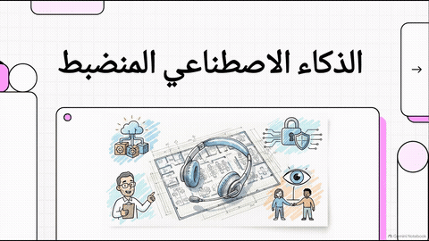

<div align="center">
  
</div>

<h1 align="center">Helix Solutions</h1>

<p align="center">
  <a href="https://github.com/Hatemshalaby15071979/Helix-Solutions/actions/workflows/ci.yml"></a>
  <a href="https://github.com/Hatemshalaby15071979/Helix-Solutions/actions/workflows/pages.yml"></a>
  
  
</p>

**The operations core, built to be owned.** Helix Solutions is the company and founder profile behind [Helix Codex](https://github.com/Hatemshalaby15071979/Helix-Codex) — governed operations software that runs on your hardware. Founded by [Hatem Shalaby](https://github.com/Hatemshalaby15071979), Contact Centre Operations and AI Implementation Lead focused on WFM and CX transformation.

> Code is open. Data stays with you. A human is always in charge.

This repository is the **master website** — the single front door for the founder's history, products, apps and dashboards. It is a dependency-free static site: plain HTML, CSS and vanilla JavaScript. No build step is required to preview it locally.

---

## The site

| Page | What it is |
|---|---|
| [`index.html`](index.html) | Root landing — the Helix Prime operations core |
| [`helix-solutions/index.html`](helix-solutions/index.html) | Company + founder profile and the full public index (the main site) |
| [`Operations___AI_Glossary_Reference_Matrix.html`](Operations___AI_Glossary_Reference_Matrix.html) | Interactive glossary linking floor symptoms, tools, domains, gates, evidence and topology |
| `index (2–9).html` | Archived page variants and project deep-dives |
| [`helix-codex-deck/`](helix-codex-deck/) | Presentation sources (PDF/PPTX) |
| [`assets/`](assets/) | Canonical Helix Solutions logo, fonts, styles, demo captions |

### Preview locally

```bash
python3 -m http.server 8000
# open http://127.0.0.1:8000/helix-solutions/
```

No dependencies. `node_modules/` (Puppeteer, used only for offline screenshot tooling) is intentionally not committed.

---

## Films

Two short films from the founder. The previews below play automatically and loop; click a preview (or its link) to watch the full film with sound.

**Shadow-Mode Pilot Partner (English)**

[](https://github.com/Hatemshalaby15071979/Helix-Solutions/releases/download/films-v1/Shadow-Mode_Pilot_Partner.mp4)

▶ [Watch the full English film ↗](https://github.com/Hatemshalaby15071979/Helix-Solutions/releases/download/films-v1/Shadow-Mode_Pilot_Partner.mp4) · also in [`helix-solutions/assets/`](helix-solutions/assets/Shadow-Mode_Pilot_Partner.mp4)

**الذكاء الاصطناعي المنضبط (Arabic)**

[](https://github.com/Hatemshalaby15071979/Helix-Solutions/releases/download/films-v1/arabic-film.mp4)

▶ [Watch the full Arabic film ↗](https://github.com/Hatemshalaby15071979/Helix-Solutions/releases/download/films-v1/arabic-film.mp4) · also in [`helix-solutions/assets/`](helix-solutions/assets/%D8%A7%D9%84%D8%B0%D9%83%D8%A7%D8%A1_%D8%A7%D9%84%D8%A7%D8%B5%D8%B7%D9%86%D8%A7%D8%B9%D9%8A_%D8%A7%D9%84%D9%85%D9%86%D8%B6%D8%A8%D8%B7.mp4)

> Why previews and not an inline player? GitHub's README sanitizer removes `<video>` tags from every external host (raw files, release assets, GitHub Pages), so a native player cannot be embedded directly in a README. The looping GIF previews above render inline, and the full films play from the release assets or the [company site](https://hatemshalaby15071979.github.io/Helix-Solutions/helix-solutions/), which has the real players with posters and Arabic layout.

---

## The portfolio

Everything is connected and synchronised under one canonical Helix Solutions mark. Thirteen public product repositories, plus this company site.

| Repository | What it does |
|---|---|
| [Helix-Codex](https://github.com/Hatemshalaby15071979/Helix-Codex) | Master project — governed operations core: six engines, nine AI roles, fail-closed by design |
| [Assay](https://github.com/Hatemshalaby15071979/Assay) | Offline sheet checks with a hash-chained report pack and a named human for every judgement call |
| [Mannschaft](https://github.com/Hatemshalaby15071979/Mannschaft) | Listening-first German learning for A1–C2, local only, built for one learner |
| [SigmaHelix-OS](https://github.com/Hatemshalaby15071979/SigmaHelix-OS) | A personal operating system on your own machine — tasks, notes, projects and calendar |
| [Sign-off](https://github.com/Hatemshalaby15071979/Sign-off) | Signed, offline evidence packs answering how AI touched a customer's records |
| [CompliProof](https://github.com/Hatemshalaby15071979/CompliProof) | Reconciles two CSV exports by key into an HTML/PDF/CSV evidence pack |
| [createlee](https://github.com/Hatemshalaby15071979/createlee) | Synthetic Signoff-shaped fixtures to rehearse the evidence gate before client data |
| [Study-Studio](https://github.com/Hatemshalaby15071979/Study-Studio) | Private local-first AI tutor: lessons, quizzes, glossaries and bilingual podcasts |
| [Helix-Education](https://github.com/Hatemshalaby15071979/Helix-Education) | Event-sourced learning engine with a replayable, sealed learner record |
| [L-D-Command-Center](https://github.com/Hatemshalaby15071979/L-D-Command-Center) | Desktop learning and career workstation that runs on your laptop |
| [live-support-assistant](https://github.com/Hatemshalaby15071979/live-support-assistant) | Explainable local RAG prototype that escalates instead of guessing |
| [work-samples](https://github.com/Hatemshalaby15071979/work-samples) | Three self-contained exercises demonstrating the operations-to-software mapping |
| [Hatemshalaby15071979](https://github.com/Hatemshalaby15071979/Hatemshalaby15071979) | Profile and portfolio front door — founder history and the public index |

The README snapshots of every repository are rendered to PDF and kept in sync in [Repos_Readmes](https://github.com/Hatemshalaby15071979) (local hub).

---

## CI/CD

- **CI** (`.github/workflows/ci.yml`) — validates HTML structure, checks the canonical brand is present, and verifies every internal asset reference resolves. Runs on every push and pull request.
- **Pages** (`.github/workflows/pages.yml`) — deploys the static site to GitHub Pages on every push to `main`.

---

## Brand

One canonical mark — [`assets/helix-solutions-logo.png`](assets/helix-solutions-logo.png) (SVG source: [`assets/helix-solutions-logo.svg`](assets/helix-solutions-logo.svg)) — is used across every project, product, README and page on the account. The same asset is distributed to each project root so the brand stays consistent offline.

---

## Licence

MIT. See [LICENSE](LICENSE). The founder's name and the Helix Solutions identity are retained in all pages and provenance notes.
